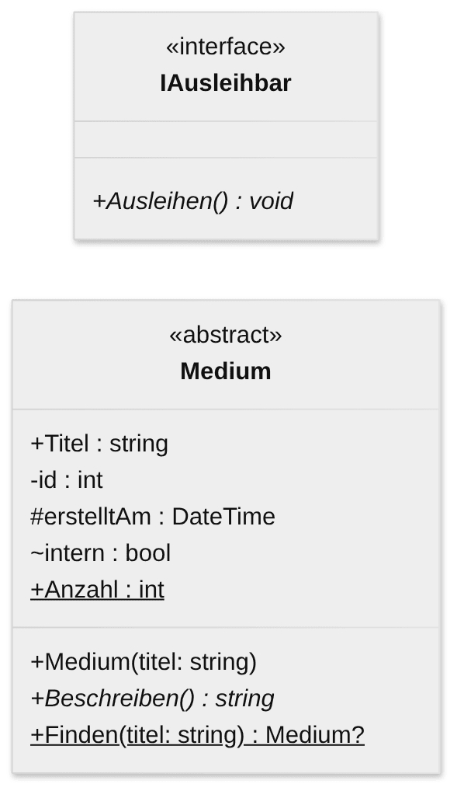
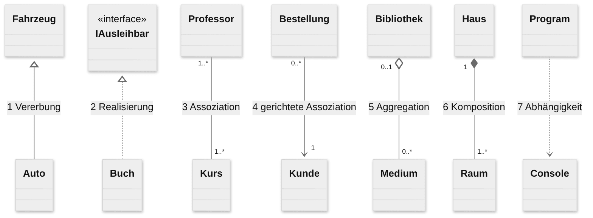

# UML-Klassendiagramme: BookLibrary und Campus Library System

Die Diagramme sind mit Mermaid geschrieben (`*.mmd`). Zum Ändern den Inhalt in <https://mermaid.live> einfügen oder neu rendern:

```zsh
pnpm dlx @mermaid-js/mermaid-cli -t neutral -b white -s 2 -i uml-legende-klasse.mmd -o uml-legende-klasse.png
```

## 1. Legende: der Klassen-Kasten



Ein Kasten hat drei Fächer: **Name** oben, **Attribute** (Fields und Properties) in der Mitte, **Operationen** (Methoden und Constructor) unten. In unseren Diagrammen bleibt ein leeres Fach leer stehen. UML erlaubt auch, Fächer ganz wegzulassen; dann sagt der Kasten nichts darüber, ob es Member gibt.

| Zeichen im Diagramm | Bedeutung | C# |
| --- | --- | --- |
| `+` | public | `public` |
| `-` | private | `private` |
| `#` | protected | `protected` |
| `~` | package | am ehesten `internal` |
| `name : Typ` | Attribut mit Typ | `public string Titel { get; set; }` |
| `Methode(param: Typ) : Rückgabetyp` | Operation mit Parametern und Rückgabetyp | `public string Beschreiben()` |
| `Klasse(param: Typ)` ohne Rückgabetyp | Constructor (verbreitete Konvention; streng nach UML: `«create» Klasse(...)`) | `public Medium(string titel)` |
| <u>unterstrichen</u> | statisch, gehört zur Klasse, nicht zur Instanz | `static` |
| *kursiv* | abstrakt, nur deklariert, ohne Implementierung | `abstract`, Interface-Methoden ohne Rumpf |
| `«interface»` | Schlüsselwort (Keyword): der Kasten ist ein Interface | `interface IAusleihbar` |
| *kursiver Klassenname* oder `{abstract}` | abstrakte Klasse (Mermaid schreibt dafür `«abstract»`, wie im Bild) | `abstract class Medium` |
| `Typ?` | kann `null` sein (C#-Schreibweise, kein UML-Standard) | `Medium?` |

UML kennt keine eigene Notation für C#-Properties. Wir zeichnen sie als Attribute. Auch `void` gibt es in UML streng genommen nicht (dort lässt man den Rückgabetyp weg); wir schreiben es wie in C#.

## 2. Legende: Linien und Pfeile



Streng genommen sind 4, 5 und 6 Varianten der Assoziation (3), und die Realisierung (2) ist eine besondere Abhängigkeit (7). Zum Lesen reicht die Tabelle.

| Nr. | Beziehung | Zeichnung | Bedeutung | Typisch in C# | Mermaid |
| --- | --- | --- | --- | --- | --- |
| 1 | Vererbung (Generalisierung) | durchgezogene Linie, hohles Dreieck an der Basisklasse | „ist ein“: ein `Auto` ist ein `Fahrzeug` | `class Auto : Fahrzeug` | `Fahrzeug <\|-- Auto` |
| 2 | Realisierung | gestrichelte Linie, hohles Dreieck am Interface | „erfüllt den Vertrag“: `Buch` implementiert `IAusleihbar` | `class Buch : IAusleihbar` | `IAusleihbar <\|.. Buch` |
| 3 | Assoziation | durchgezogene Linie, oft mit Name und Zahlen | „kennt / hat zu tun mit“; ohne Pfeil lassen wir offen, wer wen kennt | Field oder Property vom anderen Typ (in einer oder beiden Klassen) | `Professor -- Kurs` |
| 4 | Gerichtete Assoziation | durchgezogene Linie, offene Pfeilspitze | nur eine Seite kennt die andere: `Bestellung` kennt ihren `Kunde`, nicht umgekehrt | Field nur in einer der beiden Klassen | `Bestellung --> Kunde` |
| 5 | Aggregation | durchgezogene Linie, **hohle** Raute am Ganzen | „hat“, Teile leben auch ohne das Ganze: ein `Medium` gibt es auch ohne `Bibliothek` | `List<Medium>` als Field, Teile kommen von außen | `Bibliothek o-- Medium` |
| 6 | Komposition | durchgezogene Linie, **gefüllte** Raute am Ganzen | „besteht aus“, jedes Teil gehört zu genau einem Ganzen und stirbt mit ihm: kein `Raum` ohne `Haus` | `List<Raum>` als Field; meist erzeugt das Ganze die Teile selbst | `Haus *-- Raum` |
| 7 | Abhängigkeit | gestrichelte Linie, offene Pfeilspitze | „benutzt kurz“: nur als Parameter, lokale Variable oder Aufruf | `Console.WriteLine(...)`, `new Book(...)` in einer Methode | `Program ..> Console` |

Merkhilfe: **Dreieck** = Vererbung/Interface, **Raute** = Ganzes-Teil (hohl = lose, gefüllt = fest), **gestrichelt** = kein Field dahinter (Interface erfüllen oder nur benutzen).

## 3. Legende: Multiplizitäten

Die Zahlen an einem Linienende sagen, wie viele Objekte **dieser** Seite zu einem Objekt der anderen Seite gehören.

| Angabe | Bedeutung |
| --- | --- |
| `1` | genau eins |
| `0..1` | keins oder eins (in C# oft `Typ?`) |
| `*` oder `0..*` | beliebig viele, auch keins |
| `1..*` | mindestens eins |
| `1..10` | eins bis zehn |

Beispiele aus dem Bild:

- `Haus "1" *-- "1..*" Raum`: ein Haus hat mindestens einen Raum, und jeder Raum gehört zu genau einem Haus.
- `Professor "1..*" -- "1..*" Kurs`: ein Professor unterrichtet mindestens einen Kurs, und jeder Kurs hat mindestens einen Professor. Die Zahl beim Kurs beantwortet also „wie viele Kurse hat **ein** Professor?“.

## 4. BookLibrary (Code nach der Vorlesung)


- `Book` hat drei öffentliche Properties, einen öffentlichen Constructor (der Primary Constructor `Book(string title, string author, int year)`) und `DisplayInfo()`.
- `Main` ist `static`, darum unterstrichen.
- `books` und die Local Functions (`AddBook()`, `FindByTitle()`, …) stehen **in** `Main`. Sie sind keine Member der Klasse `Program`, darum stehen sie nicht im Kasten, sondern in einer Notiz.
- Die Linie ist eine **Abhängigkeit** mit `«create»` und keine Assoziation: `Program` hat kein Field vom Typ `Book`, es erzeugt `Book`-Objekte nur in `Main` und hält sie in einer lokalen Variable.

> Frage an die Gruppe: Was ändert sich im Diagramm, wenn wir eine Klasse `Library` mit einem Field `private readonly List<Book> books` bauen?

Antwort: Dann hat `Library` ein Field vom Typ `List<Book>`, und zwischen `Library` und `Book` steht eine durchgezogene Linie mit Raute an `Library`. Kommen die Bücher über `AddBook(Book book)` von außen und können auch ohne Library existieren, ist es eine Aggregation `Library "0..1" o-- "0..*" Book`. Gehört jedes Buch fest zu genau einer Library und verschwindet mit ihr, ist es eine Komposition `Library "1" *-- "0..*" Book`. `Program` hängt dann gestrichelt von `Library` ab (und von `Book`, wenn es die Bücher selbst erzeugt).

## 5. Campus Library System


Quelle: `Exercises_solutions_for_students/de/05-Campus-Library-System/campus-library-system.mmd`. Die Begründung jeder Entscheidung und die Reflexion stehen in `campus-library-system.md` im selben Ordner.

| Anforderung | Beziehung (Nr. aus Abschnitt 2) |
| --- | --- |
| `Student` und `Professor` erben von `User` | 1 Vererbung |
| `Book` implementiert `Borrowable` | 2 Realisierung |
| Ein `Professor` unterrichtet einen oder mehrere `Course` | 3 Assoziation, `1..*` an `Course` |
| Ein `Course` besteht aus 1 bis 10 `Module` | 6 Komposition, `1` an `Course`, `1..10` an `Module` |

- Alle Attribute sind `-` (private), alle Methoden `+` (public).
- `checkout()` und `returnItem()` sind im Interface kursiv (abstrakt) und in `Book` normal (implementiert).
- Die Aufgabe nennt keine Typen, darum stehen nur Namen da.
